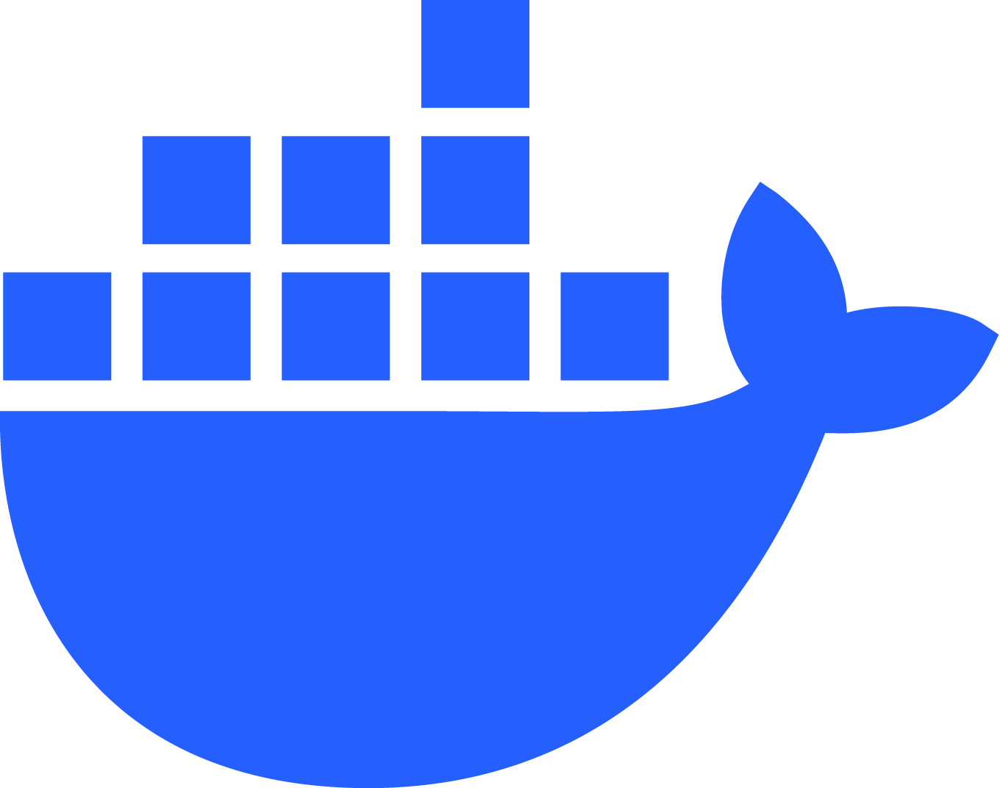
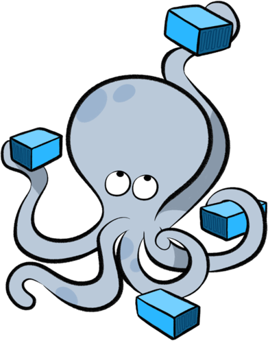

*This project has been created as part of the 42 curriculum by pledieu, abouclie, aboumall, arocca.*

<h1 align="center"><b><code>FT_TRANSCENDANCE</code></b></h1>

## 📋 Prerequisites & Docker Installation

In order to launch the project, you must have installed on your device (or session):
   -  **Docker**
   -  **Docker Compose**

### 1. Comment installer **Docker** et **Docker Compose** ?

* **Sur macOS / Windows :**
  Téléchargez et installez **Docker Desktop** depuis le site officiel [docker.com](https://www.docker.com/). Docker Compose y est déjà intégré par défaut.

* **Sur Linux (Ubuntu / Debian / Session 42 si droits admin ou machine personnelle) :**
  Si Docker n'est pas présent, vous pouvez l'installer via les commandes suivantes :
  ```bash
  # Mettre à jour les paquets
  sudo apt-get update

  # Installer Docker
  sudo apt-get install -y docker.io docker-compose-v2

  # (Optionnel) Ajouter votre utilisateur au groupe docker pour éviter de taper sudo
  sudo usermod -aG docker $USER
  newgrp docker

## Ressources

### Apprehend & Learn Django
- https://developer.mozilla.org/fr/docs/Learn_web_development/Extensions/Server-side/Django
- https://docs.djangoproject.com/en/6.1/intro/tutorial01/


---
<sub style="color: gray;">Généré en partie avec Google Gemini - A changer dans le temps</sub>

<!-- COPIE-COLLE RAPIDE -->
<!-- 🐋 Docker:  -->
<!-- 🐋 Docker Compose:  -->
