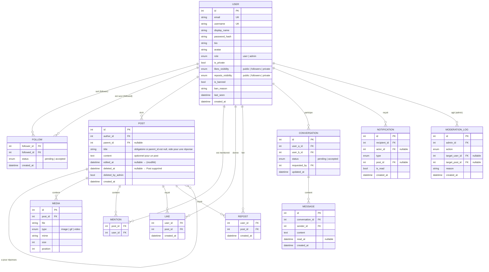
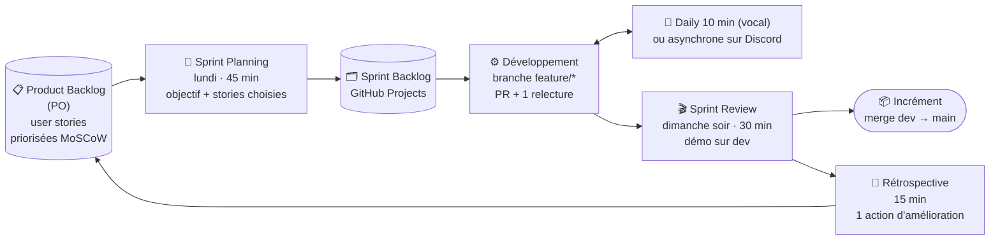
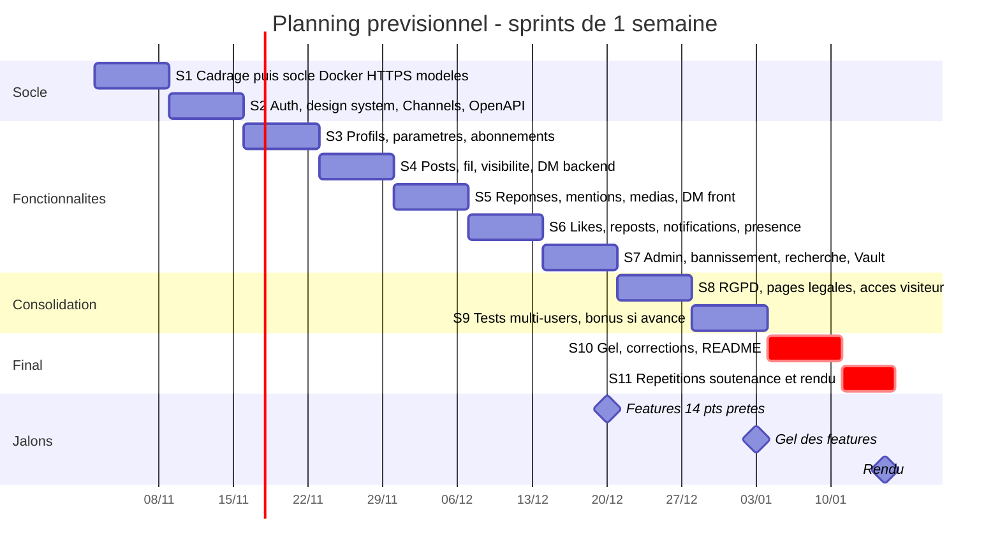

# Spécification fonctionnelle : ft_transcendence (réseau social)

> **Version :** 0.4 (brouillon, à valider en équipe)
> **Date :** 2026-11-05
> **Changements v0.2 :** les visiteurs non connectés peuvent lire le contenu public (§2, §3, §4.14).
> **Changements v0.3 :** rendu avancé au 15 janvier 2027, sprints d'une semaine (§10.3, §11).
> **Changements v0.4 :** les posts ont un titre obligatoire et un contenu optionnel, comme sur Reddit ; les réponses n'ont pas de titre (§4.4, §4.11, §6).
> **Équipe :** pledieu, abouclie, aboumall, arocca
> **Référence sujet :** [subject.json](subject.json). Les identifiants `GR*` / `TR*` / `web.*`… viennent de ce fichier.

Priorités : **Must** = indispensable (sujet ou cœur du produit), **Should** = prévu mais peut glisser, **Could** = seulement s'il reste du temps.

---

## 1. Vision et périmètre

Un réseau social simple, entre Twitter et Reddit. Les utilisateurs publient des posts courts avec médias, se répondent sous forme de fils de discussion, s'abonnent les uns aux autres, likent, republient et s'écrivent en privé en temps réel. Les comptes peuvent être publics ou privés. Des administrateurs modèrent la plateforme.

**Dans le périmètre :** comptes, profils, abonnements (public/privé), posts, réponses, mentions, médias, likes, republications, messages privés, notifications temps réel, modération, recherche, RGPD, pages légales.

**Hors périmètre :** citations de posts (quote-repost), hashtags/tendances, groupes ou conversations à plusieurs, appels audio/vidéo, transcodage vidéo, application mobile native, algorithme de recommandation.

---

## 2. Acteurs et rôles

| Rôle | Description |
|---|---|
| **Visiteur** (non connecté) | **Lecture seule** : voit le contenu des comptes publics (posts, fils, profils, médias, fil Explorer, recherche). Ne peut faire aucune action : publier, répondre, liker, republier, s'abonner, envoyer un message… (§4.14). |
| **User** | Utilisateur inscrit. Toutes les fonctionnalités sociales. |
| **Admin** | Un user avec des droits en plus : gérer les comptes, bannir, supprimer n'importe quel post, changer les rôles. Il poste, like, suit, etc. comme un user normal. |

Le premier admin est créé en ligne de commande (`createsuperuser` ou script de seed). Ensuite, un admin peut promouvoir un user en admin.

### Matrice des droits

| Action | Visiteur | User | Admin |
|---|:-:|:-:|:-:|
| S'inscrire / se connecter | ✅ | — | — |
| Voir les posts et profils des comptes **publics** | ✅ | ✅ | ✅ |
| Voir les posts des comptes **privés** (si abonné accepté) | ❌ | ✅ | ✅ |
| Rechercher, consulter le fil Explorer | ✅ | ✅ | ✅ |
| Fil Abonnements, notifications, messages, statut en ligne | ❌ | ✅ | ✅ |
| S'abonner | ❌ | ✅ | ✅ |
| Publier, répondre, liker, republier, envoyer un message | ❌ | ✅ | ✅ |
| Modifier / supprimer **ses** posts | ❌ | ✅ | ✅ |
| Supprimer **n'importe quel** post | ❌ | ❌ | ✅ |
| Voir la liste de tous les users, modifier un profil tiers | ❌ | ❌ | ✅ |
| Bannir / débannir un user | ❌ | ❌ | ✅ |
| Supprimer le compte d'un autre user | ❌ | ❌ | ✅ |
| Promouvoir / rétrograder un admin | ❌ | ❌ | ✅ |
| Voir le contenu des comptes privés sans les suivre | ❌ | ❌ | ✅ (pour la modération) |

---

## 3. Règles de visibilité (transverses)

Ces règles s'appliquent partout : fil, profil, recherche, notifications, API. **Elles sont vérifiées côté backend**, le frontend ne fait qu'afficher le résultat.

### 3.1 Compte public / privé

| | Compte **public** | Compte **privé** |
|---|---|---|
| S'abonner | Immédiat | Demande à accepter ou refuser |
| En-tête du profil (avatar, nom, bio, compteurs) | Visible par tous, **visiteurs compris** | Visible par tous, **visiteurs compris** |
| Posts, réponses, médias, listes d'abonnés/abonnements | Visibles par tous, **visiteurs compris** | Visibles seulement par les abonnés acceptés et le titulaire (jamais par un visiteur) |
| Messages privés reçus | Arrivent directement | Demande de message si aucun lien d'abonnement (§4.8) |

- Passage de **public à privé** : les abonnés existants sont conservés.
- Passage de **privé à public** : les demandes en attente sont acceptées automatiquement.
- La visibilité d'un post dépend de l'état **actuel** du compte de son auteur, pas de son état au moment de la publication.

### 3.2 Visibilité des likes et des republications

Chaque user règle **dans ses paramètres** deux options indépendantes : visibilité de ses likes et visibilité de ses republications.

| Valeur | Qui voit que *X* a liké / republié |
|---|---|
| `public` (défaut) | Toute personne qui peut voir le post, visiteurs compris |
| `abonnés` | Seulement les abonnés acceptés de *X* (donc jamais un visiteur) |
| `privé` | Seulement *X* |

- Le réglage s'applique **à tous** les likes et republications de *X*, y compris les anciens : il est évalué au moment de l'affichage.
- Le **compteur** de likes/republications d'un post compte tout le monde, de façon anonyme. Seule la **liste** des comptes est filtrée.
- Les règles du post passent toujours avant : une visibilité `public` ne rend pas visible un post privé.

> ⚠️ À valider : l'alternative est de choisir la visibilité **à chaque like**. C'est plus fin, mais plus lourd côté interface et backend. Recommandation : le réglage global.

### 3.3 Users bannis

Pendant le bannissement, le contenu d'un user banni est masqué pour tout le monde sauf les admins. Il réapparaît au débannissement.

---

## 4. Fonctionnalités

### 4.1 Authentification (AUTH)

| ID | Fonctionnalité | Prio |
|---|---|---|
| AUTH-01 | **Inscription** : email, nom d'utilisateur, mot de passe, confirmation du mot de passe, case d'acceptation des CGU et de la politique de confidentialité. | Must |
| AUTH-02 | **Connexion** par email (ou nom d'utilisateur) et mot de passe. | Must |
| AUTH-03 | **Déconnexion** : ferme la session et les connexions WebSocket. | Must |
| AUTH-04 | **Vérification de l'email** par lien envoyé à l'inscription. | Should |
| AUTH-05 | **Mot de passe oublié** : lien de réinitialisation par email, valable 1 h. | Should |
| AUTH-06 | **2FA** (TOTP avec une application d'authentification). | Could (module bonus) |
| AUTH-07 | **Connexion OAuth 42.** | Could (module bonus) |

**Règles de gestion**
- Nom d'utilisateur : 3 à 20 caractères `[a-zA-Z0-9_]`, unique sans tenir compte de la casse, non modifiable vers un nom déjà pris.
- Email unique.
- Mot de passe : 8 caractères minimum, validateurs Django, stocké haché et salé (`TR5`).
- Après 5 échecs de connexion en 15 min, la connexion est bloquée temporairement (anti-bruteforce).
- Un user banni ne peut pas se connecter. Il voit un message avec le motif du bannissement.
- Toutes les validations sont faites côté front **et** côté back (`TR6`).

### 4.2 Compte et profil (ACC)

| ID | Fonctionnalité | Prio |
|---|---|---|
| ACC-01 | **Page profil** : avatar, nom affiché, @username, bio, date d'inscription, compteurs (posts, abonnés, abonnements), badge « privé » et statut en ligne. | Must |
| ACC-02 | **Onglets du profil** : Posts · Réponses · Médias · J'aime · Republications. Chaque onglet est filtré selon le §3. | Must |
| ACC-03 | **Modifier le profil** : nom affiché (≤ 50 caractères), bio (≤ 160 caractères), avatar. | Must |
| ACC-04 | **Avatar** : upload JPG/PNG/WEBP ≤ 2 Mo, recadrage carré. Un **avatar par défaut** est utilisé s'il n'y en a pas. | Must |
| ACC-05 | **Paramètres du compte** : changer l'email, le mot de passe (ancien mot de passe demandé) et le nom d'utilisateur. | Must |
| ACC-06 | **Paramètres de confidentialité** : compte public/privé, visibilité des likes, visibilité des republications. | Must |
| ACC-07 | **Statut en ligne** : 🟢 en ligne si au moins une connexion active. Visible par ses **amis** (abonnement mutuel) et dans les conversations privées. | Must |
| ACC-08 | **Exporter ses données** (RGPD) : un fichier JSON lisible avec le profil, les posts, les likes, les republications, les abonnements et les messages. | Should (module RGPD) |
| ACC-09 | **Supprimer son compte** (§4.2.1). | Must |

#### 4.2.1 Suppression de compte (ACC-09)

1. L'user clique « Supprimer mon compte », ressaisit son mot de passe et confirme dans une fenêtre d'avertissement.
2. *(Module RGPD)* Un email de confirmation est envoyé.
3. **Toutes** les données liées au compte sont supprimées définitivement :
   - le compte et le profil, l'avatar ;
   - **tous** ses posts et réponses, avec leurs médias (fichiers inclus) ;
   - ses likes et republications ;
   - ses abonnements et abonnés, les demandes en attente ;
   - ses conversations privées et leurs messages (pour les deux participants) ;
   - ses notifications, et celles dont il est l'auteur chez les autres.
4. Les réponses des **autres** users à ses posts sont conservées et affichent « En réponse à un post indisponible ».
5. Toutes ses sessions et connexions WebSocket sont fermées immédiatement.

> Ce n'est **pas** la même chose qu'une suppression de post (§4.4). Supprimer un post laisse une trace « Post supprimé ». Supprimer son compte efface tout.

### 4.3 Relations sociales (SOC)

| ID | Fonctionnalité | Prio |
|---|---|---|
| SOC-01 | **S'abonner** à un compte public : immédiat, l'autre reçoit une notification. | Must |
| SOC-02 | **Demander à s'abonner** à un compte privé : statut « Demandé », possibilité d'annuler. | Must |
| SOC-03 | **Gérer les demandes reçues** : accepter ou refuser. Le demandeur est notifié en cas d'acceptation seulement. | Must |
| SOC-04 | **Se désabonner.** | Must |
| SOC-05 | **Retirer un abonné** de sa liste (utile surtout pour un compte privé). | Should |
| SOC-06 | **Listes** sur le profil : Abonnés · Abonnements · **Amis** (abonnement mutuel). | Must |
| SOC-07 | **Bloquer** un user : il ne peut plus voir vos posts, vous suivre ni vous écrire. Le blocage retire les abonnements dans les deux sens. | Could |

> Les **amis** (abonnement mutuel) servent à couvrir le « friends system » des modules `web.user_interaction` et `user.standard`. On peut ajouter un ami en le suivant, le retirer en se désabonnant, et voir la liste de ses amis.

### 4.4 Posts (POST)

| ID | Fonctionnalité | Prio |
|---|---|---|
| POST-01 | **Créer un post** : **titre obligatoire** (3 à 120 caractères), contenu texte (≤ 500 caractères) et médias **optionnels**. | Must |
| POST-02 | **Médias joints** (§4.5). | Must |
| POST-03 | **Répondre** à un post : une réponse est un post qui a un post parent. Elle **n'a pas de titre** et doit contenir au moins du texte ou un média. On peut répondre à une réponse, ce qui forme un fil. | Must |
| POST-04 | **Page d'un post** : le post, la chaîne de ses parents au-dessus et ses réponses en dessous (paginées, de la plus ancienne à la plus récente). | Must |
| POST-05 | **Mentions** `@username` : le texte devient un lien vers le profil, et le user mentionné reçoit une notification. | Must |
| POST-06 | **Modifier** son post : titre, texte et retrait de médias. La mention **« (modifié) »** s'affiche, avec la date de modification au survol. | Must |
| POST-07 | **Supprimer** son post (§4.4.1). | Must |
| POST-08 | **Compteurs** sur chaque post : réponses, likes, republications. | Must |

**Règles des mentions**
- 10 mentions maximum par post. Les `@inconnu` restent en texte simple.
- Pas de notification si le user mentionné **ne peut pas voir** le post (auteur privé dont il n'est pas abonné), ni s'il a bloqué l'auteur.
- Quand un post est modifié, seuls les users **nouvellement** mentionnés reçoivent une notification.

#### 4.4.1 Suppression d'un post

- Le **texte, les médias (fichiers inclus), les mentions, les likes et les republications** sont supprimés.
- La **trace reste** : le post garde sa place dans le fil et affiche **« Post supprimé »**, ou **« Post supprimé par la modération »** s'il a été supprimé par un admin. Ni auteur ni contenu ne sont affichés.
- Les réponses au post sont conservées.
- On ne peut ni liker, ni republier, ni répondre à un post supprimé.

### 4.5 Médias (MEDIA)

| ID | Fonctionnalité | Prio |
|---|---|---|
| MEDIA-01 | **Types acceptés** : images JPG/PNG/WEBP (≤ 5 Mo), GIF (≤ 10 Mo), vidéos MP4/WEBM (≤ 50 Mo, ≤ 2 min). | Must |
| MEDIA-02 | **4 médias max** par post, ou **1 vidéo** seule. | Must |
| MEDIA-03 | **Validation** du type, de la taille et du format côté client **et** côté serveur, en vérifiant le vrai type MIME et pas seulement l'extension. | Must |
| MEDIA-04 | **Aperçu** avant publication, avec possibilité de retirer un média. | Must |
| MEDIA-05 | **Barre de progression** pendant l'upload. | Must |
| MEDIA-06 | **Contrôle d'accès** : les médias d'un compte privé ne sont pas accessibles par URL directe sans autorisation. Ceux d'un compte public sont accessibles aux visiteurs. | Must |
| MEDIA-07 | **Suppression** : un média retiré ou un post supprimé entraîne la suppression du fichier. | Must |
| MEDIA-08 | Affichage : grille d'images, GIF animé, lecteur vidéo natif, image en plein écran au clic. | Must |

> Ces points couvrent toutes les exigences du module `web.file_upload`.

### 4.6 Likes (LIKE)

| ID | Fonctionnalité | Prio |
|---|---|---|
| LIKE-01 | **Liker / retirer son like** sur un post visible et non supprimé. Un seul like par user et par post, enregistré en base. | Must |
| LIKE-02 | **Liste des comptes qui ont liké**, filtrée selon le §3.2. | Must |
| LIKE-03 | **Onglet « J'aime »** du profil, filtré selon le §3.2. | Must |
| LIKE-04 | **Notification** à l'auteur, seulement si la visibilité du like le permet : `public`, ou `abonnés` si l'auteur suit celui qui like. Jamais pour un like `privé`. | Must |

### 4.7 Republications (REPOST)

| ID | Fonctionnalité | Prio |
|---|---|---|
| REPOST-01 | **Republier / annuler** une republication. Une seule par user et par post. | Must |
| REPOST-02 | Une republication apparaît dans le fil des abonnés (« *X* a republié ») et dans l'onglet Republications du profil, selon la visibilité choisie (§3.2). | Must |
| REPOST-03 | **Interdit** de republier un post d'un **compte privé**, pour éviter les fuites de contenu. | Must |
| REPOST-04 | Si le post d'origine est supprimé ou devient invisible, la republication disparaît. | Must |
| REPOST-05 | Notification à l'auteur, avec la même règle que LIKE-04. | Must |

### 4.8 Messages privés (DM)

| ID | Fonctionnalité | Prio |
|---|---|---|
| DM-01 | **Conversations à deux**, texte seul (≤ 1 000 caractères), messages reçus **en temps réel**. | Must |
| DM-02 | **Boîte de réception** : conversations triées par dernier message, aperçu, badge de non-lus. | Must |
| DM-03 | **Demandes de message** (règle ci-dessous) : onglet séparé, accepter ou refuser. | Must |
| DM-04 | **Historique** conservé en base, chargé par pages quand on remonte. | Must |
| DM-05 | Statut en ligne du correspondant et lien vers son profil depuis la conversation. | Must |
| DM-06 | Indicateur « en train d'écrire… » et accusés de lecture. | Could (module chat avancé) |
| DM-07 | Impossible d'écrire à un user banni ou qui vous a bloqué. | Must |

**Règle des demandes de message.** Quand *A* écrit à *B* :
- si *B* est **public**, le message arrive directement ;
- si *B* est **privé** et qu'il existe un abonnement accepté **dans un sens ou dans l'autre** entre *A* et *B*, le message arrive directement ;
- sinon, la conversation passe en **demande**. *B* voit les messages dans l'onglet « Demandes » :
  - s'il **accepte**, la conversation devient normale ;
  - s'il **refuse**, la conversation est supprimée sans que *A* soit prévenu.

> ⚠️ À valider : la condition exacte de la demande. Votre formulation (« si le compte est en privé et que l'utilisateur ne follow pas ») pouvait se lire de deux façons. J'ai retenu « aucun abonnement dans aucun sens », qui est la plus permissive pour les personnes qui se connaissent déjà.

### 4.9 Fil d'actualité et navigation (FEED)

| ID | Fonctionnalité | Prio |
|---|---|---|
| FEED-01 | **Fil « Abonnements »** : posts et republications des comptes suivis et de soi-même, du plus récent au plus ancien, chargés au défilement. | Must |
| FEED-02 | **Fil « Explorer »** : posts récents des comptes publics. C'est la page d'accueil des visiteurs. | Must |
| FEED-03 | Indicateur « N nouveaux posts » en temps réel, avec un clic pour les afficher. | Should |
| FEED-04 | Navigation en **SPA**, sans rechargement complet de page. | Must |

### 4.10 Notifications (NOTIF)

| ID | Fonctionnalité | Prio |
|---|---|---|
| NOTIF-01 | **Cloche** avec compteur de non-lues, mise à jour en temps réel. | Must |
| NOTIF-02 | **Page Notifications** : liste paginée, tout marquer comme lu, clic qui ouvre l'élément concerné. | Must |
| NOTIF-03 | **Toast de confirmation** pour **chaque** action de création, modification ou suppression faite par l'user : post publié, modifié ou supprimé, profil mis à jour, abonnement… | Must |
| NOTIF-04 | Les notifications liées à un post ou un compte supprimé disparaissent. | Must |

**Types de notifications persistantes**

| Événement | Destinataire | Catégorie |
|---|---|---|
| Nouvel abonné | Compte suivi | création |
| Demande d'abonnement reçue / acceptée | Compte privé / demandeur | création / modification |
| Mention dans un post | User mentionné | création |
| Mention ajoutée en modifiant un post | User nouvellement mentionné | modification |
| Réponse à un de mes posts | Auteur du parent | création |
| Like / republication (selon la visibilité) | Auteur du post | création |
| Nouvelle demande de message | Destinataire | création |
| Mon post a été supprimé par la modération | Auteur | suppression |
| Mon rôle a changé (promu ou rétrogradé admin) | User concerné | modification |

> Le module `web.notifications` demande un système de notification « pour toutes les actions de création, modification et suppression ». Les toasts (NOTIF-03) et les notifications persistantes couvrent les trois catégories. C'est le module dont la validation est la plus subjective : il faudra le montrer de façon exhaustive en soutenance.

### 4.11 Recherche (SEARCH)

| ID | Fonctionnalité | Prio |
|---|---|---|
| SEARCH-01 | Recherche de **users** par nom d'utilisateur ou nom affiché. | Should |
| SEARCH-02 | Recherche de **posts** par mots-clés dans le titre et le contenu, dans la limite des posts visibles. | Should |
| SEARCH-03 | **Filtres** : type (users / posts), « avec médias », période (24 h, 7 j, 30 j, tout), auteur. | Should |
| SEARCH-04 | **Tri** : plus récents / plus populaires (likes + republications). | Should |
| SEARCH-05 | **Pagination.** | Should |

### 4.12 Administration et modération (ADM)

Ces fonctionnalités passent par une **interface d'administration** dans la SPA, visible seulement par les admins. L'admin Django ne suffit pas : le module demande des vues différentes selon le rôle.

| ID | Fonctionnalité | Prio |
|---|---|---|
| ADM-01 | **Liste des users** avec recherche, filtres (rôle, banni) et pagination. | Must |
| ADM-02 | **Fiche user** : voir toutes ses infos et ses posts, même si le compte est privé. | Must |
| ADM-03 | **Modifier un user** : remettre à zéro l'avatar, la bio ou le nom affiché (contenu inapproprié). | Must |
| ADM-04 | **Bannir** avec un motif obligatoire. Les sessions et WebSockets du user sont fermés immédiatement et son contenu est masqué (§3.3). **Débannir.** | Must |
| ADM-05 | **Supprimer un compte** (même cascade que ACC-09). | Must |
| ADM-06 | **Supprimer n'importe quel post** : affiche « Post supprimé par la modération » et notifie l'auteur. | Must |
| ADM-07 | **Changer le rôle** d'un user (user ↔ admin). | Must |
| ADM-08 | **Journal de modération** : qui a fait quoi, sur qui, quand, avec quel motif. | Should |
| ADM-09 | Bouton **« Signaler »** sur un post et file de signalements pour les admins. | Could |

**Règles**
- Un admin ne peut ni se bannir, ni se supprimer, ni se rétrograder lui-même depuis l'interface d'administration.
- Pour bannir un admin, il faut d'abord le rétrograder.
- Il doit toujours rester au moins un admin.

### 4.13 Pages légales et interface générale (UI)

| ID | Fonctionnalité | Prio |
|---|---|---|
| UI-01 | **Politique de confidentialité** : données collectées, finalités, durée de conservation, droits RGPD, contact. Contenu réel, pas de texte factice (`GR6`). | Must |
| UI-02 | **Conditions d'utilisation** : règles de conduite, contenus interdits, modération et bannissement, suppression de compte (`GR6`). | Must |
| UI-03 | **Liens dans le pied de page**, accessibles depuis toutes les pages, y compris pour les visiteurs. | Must |
| UI-04 | **Responsive** (mobile, tablette, ordinateur) avec un framework CSS (`TR1`, `TR2`). | Must |
| UI-05 | **Aucune erreur ni warning** dans la console de Chrome (`GR5`). | Must |
| UI-06 | Pages 404 et erreur génériques, états de chargement et états vides. | Must |
| UI-07 | **Design system** : palette, typographie, icônes, au moins 10 composants réutilisables documentés. | Should (module bonus) |

### 4.14 Accès visiteur (VIS)

| ID | Fonctionnalité | Prio |
|---|---|---|
| VIS-01 | Un visiteur arrive sur le **fil Explorer** et peut lire les posts, les fils de discussion et les profils des comptes publics, ainsi que leurs médias. | Must |
| VIS-02 | Il peut utiliser la **recherche**. Les résultats ne contiennent que du contenu public. | Should |
| VIS-03 | Les boutons d'action (répondre, liker, republier, s'abonner, envoyer un message) restent **visibles**. Au clic, une fenêtre invite à se connecter ou à s'inscrire. Après la connexion, l'utilisateur revient sur la page où il était. | Must |
| VIS-04 | Un bandeau « Connectez-vous pour participer » est affiché en permanence, avec les boutons Connexion et Inscription. | Must |
| VIS-05 | Un visiteur ne voit **jamais** : le contenu des comptes privés, le statut en ligne, les likes et republications en visibilité `abonnés` ou `privé`, le contenu des users bannis. | Must |
| VIS-06 | Toutes les routes d'écriture de l'API refusent les requêtes non authentifiées (401). La lecture anonyme a un **rate limiting** plus strict, pour limiter l'aspiration du contenu. | Must |

> Le rôle visiteur (« guest ») renforce aussi le module `user.permissions`, qui cite justement guest / user / admin et demande des vues différentes selon le rôle.

---

## 5. Exigences non fonctionnelles (issues du sujet)

| Réf. | Exigence | Responsable principal |
|---|---|---|
| GR1 | Frontend + backend + base de données | Tous |
| GR2 | Commits de **tous** les membres, messages clairs | Tous |
| GR3 | Lancement avec **une seule commande** (`make`) | DevOps |
| GR4/GR5 | Dernière version de Chrome, console propre | Frontend |
| GR6 | Pages légales réelles | Frontend |
| GR7 | Multi-utilisateurs sans race conditions : contraintes d'unicité en base, transactions, tests de concurrence | Backend + WebSocket |
| TR3 | `.env` ignoré par git + `.env.example`, aucun secret dans le code | DevOps |
| TR4 | Schéma de base de données clair (§6) | Backend |
| TR5 | Mots de passe hachés et salés | Backend |
| TR6 | Validation front **et** back | Frontend + Backend |
| TR7 | **HTTPS** partout depuis l'extérieur, WSS pour les WebSockets | DevOps |
| — | README en anglais avec les 10 sections obligatoires | Tous (coordination PM) |

---

## 6. Modèle de données conceptuel



**Contraintes importantes** (elles évitent les race conditions de `GR7`) :
- unicité de `(follower, followed)`, de `(user, post)` pour les likes et les republications, et de la paire d'users d'une conversation ;
- `ON DELETE CASCADE` depuis `USER` pour la suppression de compte, `SET NULL` sur `POST.parent` pour les réponses des autres.

---

## 7. Écrans

| Écran | Accès |
|---|---|
| Connexion / Inscription / Mot de passe oublié | Visiteur |
| Fil Explorer | Tous (page d'accueil des visiteurs) |
| Fil Abonnements | User |
| Page d'un post (fil de discussion) | Tous (lecture seule pour les visiteurs) |
| Profil (Posts · Réponses · Médias · J'aime · Republications) | Tous (lecture seule pour les visiteurs) |
| Listes Abonnés · Abonnements · Amis | Tous (selon §3.1) |
| Demandes d'abonnement | User |
| Messages (boîte de réception · Demandes · Conversation) | User |
| Notifications | User |
| Recherche | Tous |
| Paramètres (Profil · Compte · Confidentialité · Sécurité · Mes données · Supprimer le compte) | User |
| Administration (Users · Fiche user · Journal de modération) | Admin |
| Politique de confidentialité · Conditions d'utilisation · 404 | Tous |

---

## 8. Modules visés et points

### 8.1 Couverts par la spécification telle qu'écrite (13 pts)

| Module | Type | Pts | Couvert par |
|---|---|:-:|---|
| `web.frameworks_full` : Django + React | Majeur | 2 | Stack |
| `web.realtime` : WebSockets | Majeur | 2 | DM, notifications, statut en ligne, nouveaux posts |
| `web.user_interaction` : chat + profil + amis | Majeur | 2 | DM, ACC-01, SOC-06 (amis = abonnement mutuel) |
| `user.standard` : profil, avatar, amis + statut en ligne | Majeur | 2 | ACC-01 à 07, SOC |
| `user.permissions` : CRUD users, rôles, vues selon le rôle | Majeur | 2 | ADM, matrice §2 |
| `web.orm` : Django ORM | Mineur | 1 | Stack |
| `web.notifications` | Mineur | 1 | NOTIF |
| `web.file_upload` | Mineur | 1 | MEDIA |
| **Sous-total** | | **13** | ❌ il manque 1 point |

> Ce que tu as décrit au départ ne donnait pas 14 points. Pour arriver à ces 13 points, j'ai ajouté ce que les modules exigent : le statut en ligne, l'avatar par défaut, la liste d'amis, le CRUD des users et la gestion des rôles côté admin, la barre de progression et le contrôle d'accès des médias.

### 8.2 Ajouts recommandés (cible : 17 pts, soit 3 de marge)

| Module | Type | Pts | Pourquoi |
|---|---|:-:|---|
| `data.gdpr` | Mineur | 1 | La suppression de compte est déjà prévue. Il reste l'export des données et les emails de confirmation. |
| `web.advanced_search` | Mineur | 1 | Indispensable pour trouver des users. Faible coût. |
| `security.waf_vault` : ModSecurity + HashiCorp Vault | Majeur | 2 | Le gros chantier naturel du profil DevOps/cyber. |
| **Total visé** | | **17** | ✅ 14 + 3 de marge |

### 8.3 Extensions si on a de l'avance (bonus, plafonné à +5 au-delà de 14)

| Module | Type | Pts | Coût estimé |
|---|---|:-:|---|
| `web.design_system` | Mineur | 1 | Faible : les composants sont faits de toute façon, il reste à les documenter. |
| `user.2fa` | Mineur | 1 | Faible à moyen |
| `user.oauth` (42) | Mineur | 1 | Faible |
| `gaming.advanced_chat` | Mineur | 1 | ⚠️ À éviter : 2 des 6 exigences demandent un jeu. |
| `devops.monitoring` (Prometheus/Grafana) | Majeur | 2 | Moyen |

Au-delà de 19 points (14 + 5 de bonus), un module de plus ne rapporte rien.

### 8.4 Risques sur les points

| Risque | Mitigation |
|---|---|
| « Friends system » contre abonnements : un évaluateur strict pourrait demander de vrais « amis » | Onglet **Amis** explicite (abonnement mutuel) avec statut en ligne. Le justifier dans le README. |
| Le module notifications est interprété de façon stricte | NOTIF-03 couvre toutes les actions de création, modification et suppression. Préparer une démo exhaustive. |
| WAF + Vault est un chantier lourd et peu documenté | Le commencer dès le sprint 2. Si ça bloque fin décembre, basculer sur `devops.monitoring` + `user.2fa`. |
| Vidéos lourdes | Pas de transcodage, limites strictes (50 Mo, MP4/WEBM). |

---

## 9. Points à valider en équipe

1. Visibilité des likes et republications : **réglage global** (recommandé) ou choix à chaque action (§3.2) ?
2. Condition exacte d'une demande de message privé (§4.8).
3. La suppression de compte efface aussi les conversations pour **l'autre** participant (§4.2.1) : OK ?
4. Posts supprimés : afficher l'auteur ou non (ici : non) ?
5. Le blocage (SOC-07) et le signalement (ADM-09) restent-ils en « Could » ?
6. Choix final des modules bonus (§8.3).

---

## 10. Répartition du travail

### 10.1 Rôles d'organisation (proposition)

| Membre (à attribuer) | Spécialité | Rôle imposé par le sujet | Pourquoi |
|---|---|---|---|
| Membre 1 | **Backend** | **Tech Lead** | Il conçoit le schéma de base de données et le contrat d'API dont dépendent les autres. |
| Membre 2 | **Frontend** | **Product Owner** | Il est le plus proche de l'expérience utilisateur et vérifie le respect du sujet et des pages légales. |
| Membre 3 | **WebSocket / temps réel** | Développeur, référent qualité (tests multi-utilisateurs) | |
| Membre 4 | **DevOps / Cyber** | **Project Manager / Scrum Master** | Il gère le board, la CI et le planning, et voit toute la chaîne. |

### 10.2 Lots par spécialité

Estimation en **jours-personne (j-p)**. Un j-p correspond à environ 6 h de travail effectif.

**🟦 Backend (Django + DRF) : environ 38 j-p**

| Tâche | j-p |
|---|:-:|
| Schéma de base de données, modèles, migrations, données de test | 3 |
| Authentification (inscription, connexion, vérification email, mot de passe oublié, anti-bruteforce) | 5 |
| Profil et paramètres du compte, avatar | 3 |
| Abonnements, demandes, amis | 4 |
| Posts : CRUD, réponses, suppression logique, modification, extraction des mentions | 6 |
| Likes et republications avec règles de visibilité | 4 |
| Fils, page de post, **moteur de règles de visibilité** (§3) | 5 |
| API d'administration : permissions, bannissement, rôles, journal | 4 |
| Documentation OpenAPI et tests de l'API | 4 |

**🟩 Frontend (React SPA) : environ 38 j-p**

| Tâche | j-p |
|---|:-:|
| Setup : routing SPA, framework CSS, design system (au moins 10 composants) | 6 |
| Pages d'authentification | 3 |
| Profil, paramètres, confidentialité | 5 |
| Interface des abonnements, listes, demandes | 3 |
| Rédaction d'un post et médias (aperçu, progression, validation) | 4 |
| Fils, carte de post (« modifié », « supprimé »), page de post, likes et republications | 6 |
| Interface d'administration | 4 |
| Interface de recherche | 2 |
| Pages légales, pied de page, responsive, console propre | 5 |

**🟨 WebSocket / temps réel : environ 31 j-p**

| Tâche | j-p |
|---|:-:|
| Infra Django Channels + Redis, authentification WebSocket, reconnexion | 4 |
| Messages privés côté backend : modèles, règle des demandes, temps réel | 4 |
| Messages privés côté frontend : boîte de réception, demandes, conversation | 5 |
| Notifications côté backend : événements, persistance, envoi en temps réel | 4 |
| Notifications côté frontend : cloche, toasts, page | 3 |
| Statut en ligne, déconnexion immédiate au bannissement, « nouveaux posts » | 3 |
| **Médias côté backend** : validation MIME, stockage, contrôle d'accès, suppression | 4 |
| Tests multi-utilisateurs et de concurrence (`GR7`) | 4 |

**🟥 DevOps / Cyber : environ 33 j-p**

| Tâche | j-p |
|---|:-:|
| Docker Compose complet, healthchecks, `make` en une commande | 3 |
| Nginx reverse proxy **HTTPS/WSS**, service des fichiers statiques et des médias protégés | 3 |
| CI GitHub Actions (lint + tests), gestion du `.env` | 2 |
| **ModSecurity / WAF durci** | 5 |
| **HashiCorp Vault** : secrets de Django, Postgres, SMTP | 5 |
| Envoi d'emails (SMTP, Mailpit en dev) | 2 |
| **Module RGPD** : export des données, cascade de suppression, emails de confirmation | 3 |
| **Recherche avancée** (backend) | 3 |
| Sécurité applicative : rate limiting, en-têtes, CORS/CSRF, audit | 3 |
| Coordination du README et du schéma de base de données | 4 |

J'ai confié la recherche et le RGPD au profil DevOps pour décharger le backend, qui porte le cœur du produit.

### 10.3 Estimation globale

| | j-p |
|---|:-:|
| Développement (somme des lots) | ~140 |
| Transverse : réunions, revues de code, corrections, préparation de la soutenance (~10 %) | ~14 |
| Marge d'imprévus (~10 %) | ~14 |
| **Total** | **~168 j-p** |

**Contrainte : rendu au plus tard le 15 janvier 2027**, soit environ 10,5 semaines à partir du 2 novembre 2026.

**Capacité**, en travaillant tous en parallèle, week-ends compris :

| Période | Calcul | j-p |
|---|---|:-:|
| 2 nov. → 20 déc. (7 semaines) | 4 pers. × 5 j effectifs/sem. × 7 | 140 |
| 21 déc. → 3 janv. (fêtes, rythme réduit) | 4 pers. × 2,5 j × 2 | 20 |
| 4 → 15 janv. (gel puis soutenance) | 4 pers. × 5 j × 1,5 | 30 |
| **Total** | | **~190 j-p** |

➡️ **C'est faisable, mais à condition de tenir environ 5 jours effectifs par semaine et par personne** (≈ 30 h/semaine). Il reste une vingtaine de j-p de marge au-delà de l'estimation. Si le rythme baisse, voici l'ordre dans lequel couper :
1. les « Could » : SOC-07, ADM-09, DM-06, FEED-03 ;
2. les modules bonus (§8.3) ;
3. si WAF + Vault n'est pas fonctionnel le 20 décembre, le remplacer par `user.2fa` + `web.design_system` (2 mineurs, moins risqués).

### 10.4 Travailler en parallèle sans se bloquer

- **Contrat d'API d'abord** (sprints 1 et 2) : le backend publie un schéma **OpenAPI** (drf-spectacular). Le frontend développe sur des mocks (MSW) en attendant les vrais endpoints.
- **Contrat des événements WebSocket** : un document `docs/ws-events.md` qui liste chaque type d'événement et son contenu.
- **Moteur de visibilité** (§3) : codé **une seule fois** côté backend et réutilisé par l'API, la recherche et les notifications.

---

## 11. Organisation agile : Scrum allégé

### 11.1 Le cycle d'un sprint (1 semaine)

Comme l'équipe travaille en parallèle et aussi le week-end, un sprint dure **une semaine, du lundi au dimanche**. Des sprints courts donnent un retour rapide et laissent peu de place au retard, ce qui est indispensable avec une échéance à 10 semaines.



### 11.2 Rituels

| Rituel | Quand | Durée | Animateur | Résultat |
|---|---|---|---|---|
| Sprint Planning | Lundi | 45 min | PM | Objectif de la semaine et stories estimées |
| Daily | Chaque jour travaillé | 10 min en vocal, ou message Discord *Fait / Je fais / Bloqué par* | PM | Blocages levés dans la journée |
| Refinement | Jeudi | 20 min | PO | Stories de la semaine suivante prêtes (critères d'acceptation) |
| Sprint Review | Dimanche soir | 30 min | PO | Démo et validation par le PO |
| Rétrospective | Après la review | 15 min | PM | 1 action concrète pour la semaine suivante |

### 11.3 Outils et workflow Git

```text
 GitHub Projects (board)
 ┌──────────┬───────────────┬─────────────┬──────────────┬────────┐
 │ Backlog  │ Sprint (Todo) │ In Progress │ Review (PR)  │  Done  │
 └──────────┴───────────────┴─────────────┴──────────────┴────────┘
     ↑ PO priorise              ↑ 2 tickets max par personne en cours

 Git
 main ────────────●─────────────────●──────────  (protégée : 1 merge par sprint, toujours démontrable)
                  ↑                 ↑
 dev  ──●──●──●──●──●──●──●──●──●──●──●───────  (intégration, protégée : PR obligatoire)
         ↑     ↑        ↑
 feature/auth-signup  feature/dm-requests  fix/media-upload-size ...
```

- **Branches :** `feature/<lot>-<sujet>`, `fix/...`, `chore/...`.
- **Commits :** `feat(posts): add soft delete` (Conventional Commits, en anglais pour le README et la soutenance).
- **Pull requests :** au moins 1 relecture par un **autre** membre, CI au vert. Le Tech Lead relit les PR critiques (schéma de base de données, sécurité).

### 11.4 Definition of Done

Une story est « Done » quand :
- [ ] les critères d'acceptation sont remplis et le PO l'a validée en review ;
- [ ] les entrées sont validées côté front **et** côté back ;
- [ ] les règles de visibilité (§3) sont respectées et testées ;
- [ ] il n'y a aucune erreur ni warning dans la console de Chrome ;
- [ ] il y a des tests (au minimum ceux de l'API) et la CI est au vert ;
- [ ] la PR a été relue et mergée sur `dev` ;
- [ ] l'OpenAPI ou `ws-events.md` sont à jour si besoin.

### 11.5 Planning prévisionnel (2 nov. 2026 → 15 janv. 2027)



| Sprint | Dates | Objectif | Backend | Frontend | WebSocket | DevOps/Cyber |
|---|---|---|---|---|---|---|
| **S1** | 2 → 8 nov. | « Tout le monde sait quoi faire, le socle tourne » | Validation de la spec, schéma BDD, modèles | Maquettes, choix du framework CSS, setup Vite/routing | `ws-events.md` v0, Redis | Board, conventions Git, CI, nginx HTTPS, compose complet |
| **S2** | 9 → 15 nov. | « Je m'inscris et je me connecte en HTTPS » | Auth complète, OpenAPI v1 | Design system (tokens + composants de base), pages d'auth | Channels + auth WebSocket | `.env` propre, SMTP (Mailpit) |
| **S3** | 16 → 22 nov. | « J'ai un profil et je suis des gens » | Profil, paramètres, abonnements/demandes/amis | Profil, paramètres, interface des abonnements | Infra de présence (base du statut en ligne) | Début du WAF (ModSecurity) |
| **S4** | 23 → 29 nov. | « Je poste et je vois un fil » | Posts CRUD, fil, **moteur de visibilité** | Rédaction de post, fil, carte de post | DM backend (modèles, règle des demandes) | WAF, sécurité applicative (rate limiting, en-têtes) |
| **S5** | 30 nov. → 6 déc. | « Les conversations prennent forme » | Réponses, mentions, modification/suppression | Page de post (fil), médias (aperçu, progression) | DM front, backend des médias | WAF durci, service protégé des médias via nginx |
| **S6** | 7 → 13 déc. | « Le réseau est vivant » | Likes, republications, visibilité | Likes, republications, onglets du profil | Notifications backend + front, statut en ligne | Début de Vault |
| **S7** | 14 → 20 déc. | « C'est modéré et on trouve tout » | API d'admin, bannissement, journal | Interface d'admin, interface de recherche | Déconnexion immédiate au bannissement, « nouveaux posts » | Vault terminé, backend de la recherche |
| **S8** | 21 → 27 déc. *(fêtes)* | « Conforme au sujet » | Accès visiteur (lecture anonyme), tests de l'API | Pages légales, accès visiteur, responsive | Tests de concurrence (`GR7`) | RGPD : export, cascade, emails |
| **S9** | 28 déc. → 3 janv. *(fêtes)* | « Solide » | Corrections | Console propre, finitions | Tests multi-utilisateurs | Bonus (2FA) si avance |
| **S10** | 4 → 10 janv. | **Gel** : plus aucune nouvelle fonctionnalité | Corrections, README (sections techniques) | Corrections, captures pour le README | Corrections | README, schéma BDD, vérification de `make` sur une machine vierge |
| **S11** | 11 → 15 janv. | Soutenance | Répétitions croisées : chacun présente le lot d'un autre. Rendu le **15 janvier**. | | | |

> Chaque membre doit pouvoir expliquer **tout** le projet en soutenance. En S10 et S11, chacun présente son lot aux autres, puis le lot de quelqu'un d'autre.

**Règle anti-retard :** si une story Must n'est pas terminée le dimanche, elle passe **en tête** du sprint suivant et le PM la signale. Si 2 sprints de suite finissent en retard, on coupe dans la liste du §10.3.
